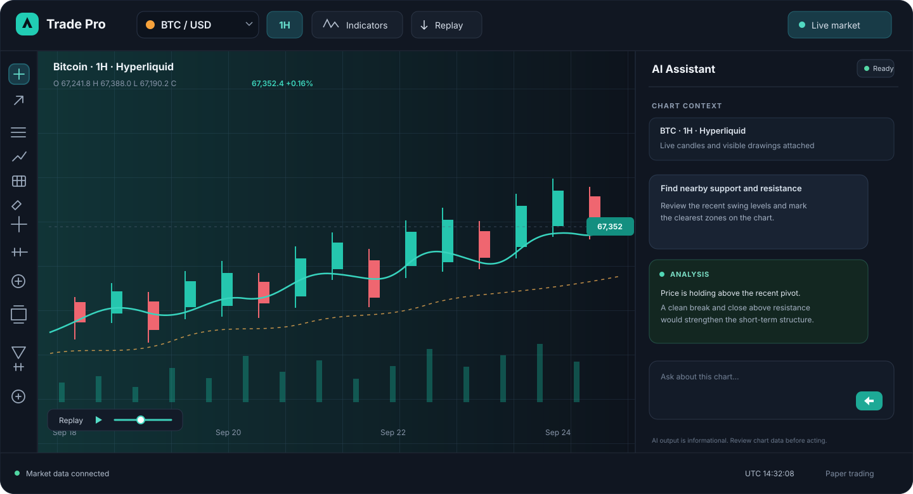

# Trade Pro

Trade Pro is a browser-based crypto charting and trading workspace built with React, TypeScript, Vite, and [`@luxalgo/vela/workspace`](https://www.npmjs.com/package/@luxalgo/vela). It brings charting, market data, indicators, drawings, replay, AI assistance, and order tools together in one interface.



<p align="center"><em>Illustrative preview of the charting workspace</em></p>

## Highlights

- Interactive, multi-layout chart workspace with symbol and timeframe controls.
- Live crypto market data, including Hyperliquid chart data.
- Technical indicators, saved scripts, drawing tools, favorites, and object controls.
- Bar replay with playback controls for reviewing historical price action.
- AI chart assistant with configurable compatible endpoint, API key, and model.
- Market, order, and paper-trading panels, plus optional account and cloud-sync features.
- Installable progressive web app support.

## Requirements

- Node.js 22 or newer (the expected version is recorded in `.nvmrc`).
- npm.

## Run locally

```bash
git clone https://github.com/SanyamVerma123/cryptolab.git
cd cryptolab
npm install
npm run dev
```

Open the local URL printed by Vite, usually `http://localhost:5173`.

To create and preview a production build:

```bash
npm run build
npm run preview
```

## AI assistant setup

Open the AI panel's settings and enter an API-compatible endpoint, API key, and model. In local development, the Vite server provides the AI relay. The relay's saved configuration is kept in `src/server/ai.config.json`, which is ignored by Git so credentials stay out of commits. For a deployment with a separate relay, copy `.env.example` to a local environment file and set `VITE_AI_RELAY_URL` to that relay's URL.

Never commit API keys or `.env.local` files. Keep server-side secrets in the environment of the machine or hosting service that runs the relay.

## Project layout

```text
src/
  components/  Chart, replay, AI, indicator, settings, and trading panels
  lib/         Market-data providers, chart state, persistence, and AI client
  server/      Development and deployment relay handlers
  styles/      Application and component styles
public/        App icons, manifest, and replay controls
docs/          README preview artwork
```

## Configuration notes

- `.env.example` documents the optional `VITE_AI_RELAY_URL` setting.
- Other integrations may be configured in the app or through their corresponding environment variables.
- Do not put private API keys in client-side `VITE_` variables; values with that prefix are bundled into the browser app.

## Scripts

| Command | Description |
| --- | --- |
| `npm run dev` | Start the Vite development server and local relay middleware. |
| `npm run build` | Build the production app. |
| `npm run preview` | Serve the production build locally. |

